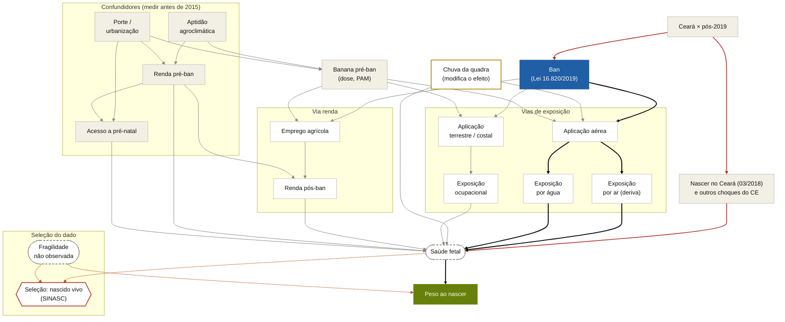
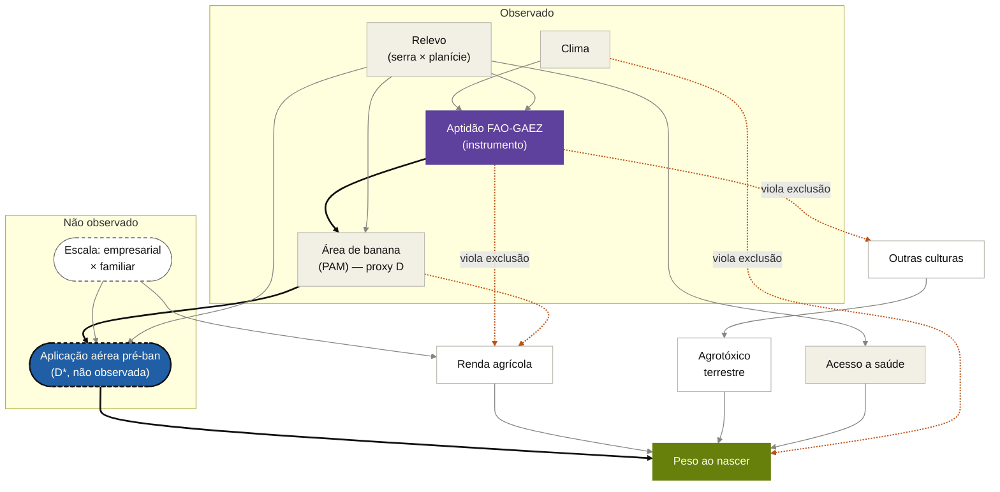
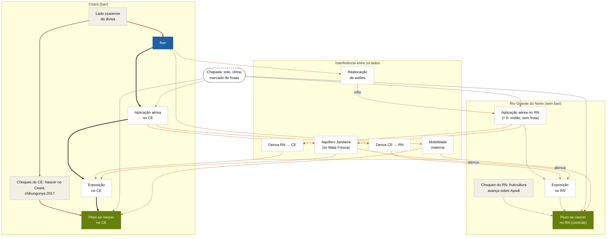
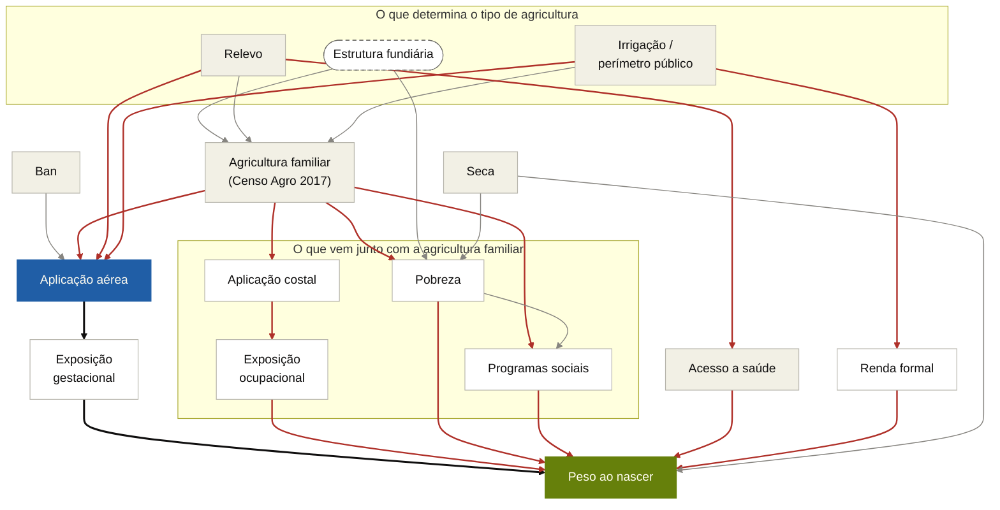
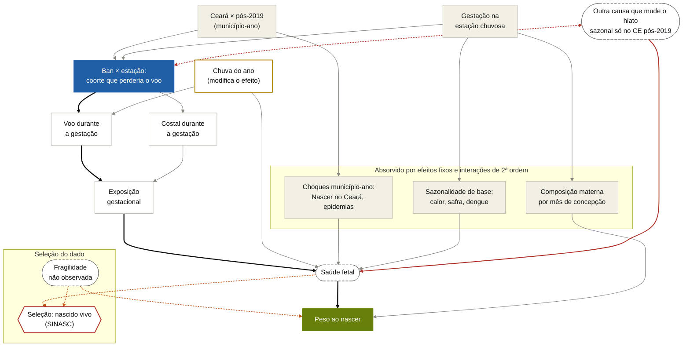

# 22 — O ban como avaliação de política pública: teoria da mudança, SUTVA, checklist do Mixtape e DAGs

*ARS Stage 1, 2026-11-10. Complementa o doc 20. Enquadra o Ensaio 1 na língua
da disciplina Avaliação de Políticas Públicas (PECO 5046-6046, PPGEco/UFES,
profs. Ana Carolina Giuberti e Renato Seixas) e de Cunningham (2021).*

## 0. Proveniência — ler antes de citar

1. **Material da disciplina = notas de segunda mão.** Usei só
   `fcarva/aval-pol/notas/disciplina/` (`01-slides-e-guias.md`,
   `03-gertler.md`, `04-itau-magenta-adb.md`), sínteses feitas em 23/09/2026.
   Os PDFs dos slides não estão versionados e não foram vistos. Cito
   `C01:linha`, `C03:linha`, `C04:linha`. Nada da LICC foi trazido.
2. **As aulas de métodos (DiD, VI, RD, sintético) não estão nas notas.** O
   que "o curso diz" sobre esses métodos aqui vem de Gertler, Itaú e ADB.
3. **Mixtape = 1ª edição, versão web** (`mixtape-1ed.netlify.app`).
   `mixtape.scunning.com` hoje serve a 2ª edição ("The Remix", em
   construção). Só o cap. 3 foi lido inteiro; nos demais, as seções
   conceituais. Trechos da 2ª edição estão marcados **[2ª ed.]** e não devem
   ser citados como "Cunningham (2021)".
4. **Os DAGs foram checados por programa em 2026-11-10** (aciclicidade e
   d-separação com `networkx`; o pacote `dagitty` do R não está no ambiente).
   A checagem corrigiu duas afirmações da primeira versão (§5, ⚠️).
   ⬜ Repetir em `dagitty.net`.
5. Direções de viés (§3) e conjuntos de ajuste (§5) são **raciocínio desta
   rodada**, não das fontes.

---

## 1. A língua do curso (o que usar na dissertação)

| conceito | como o curso diz | fonte |
|---|---|---|
| Resultados potenciais | `Y_i(1)`, `Y_i(0)`; tratamento `T_i`; impacto `β_i = Y_i(1) − Y_i(0)` | C01:542-548 |
| Parâmetros | **EMP** (ATE), **EMPT** (ATT) = `E[β_i / T_i = 1]`, **EMPNT** (ATU) | C01:558-566 |
| Decomposição | diferença simples = EMP + viés de seleção + viés de efeitos heterogêneos | C01:587-602 |
| Grupo de comparação válido — **três quesitos** | (1) mesmas características médias "ou, pelo menos, [...] a mesma tendência para a variável de resultado"; (2) **o tratamento não pode afetar o grupo de comparação, direta ou indiretamente**; (3) reagem igual ao programa | C01:483-487 |
| Contrafactuais falsos | antes-e-depois; inscritos × não inscritos | C01:492-501 |
| **SUTVA** | *ausência de interferência* (transbordamento, rede, pares, equilíbrio geral) e *ausência de variação oculta nos tratamentos* ("a 'dosagem' [...] é uniforme") | C01:628-639 |
| Ameaças à validade interna | viés de seleção; variável de confusão; maturação; efeitos de teste; transbordamento; tamanho da amostra; eventos externos; instrumentação; atrito | C01:649-651 |
| Validade externa | ampliação (*scale up*) × transposição; "mecanismo de mapeamento" e "elo rompido" | C01:668-708 |
| Poder | EMD; 80% / 5%; "pelo menos, 30 a 50 conglomerados em cada um dos grupos" | C01:773-807 |
| DD em Gertler | "igualdade de tendências" que "não se prova"; **quatro testes**: tendências pré, grupo de tratamento falso, resultado falso, grupos de comparação diferentes | C03:332-360 |
| Transbordamento em Gertler | precisa de "duas perguntas (direta e indireta) e de um grupo de comparação adicional" | C03:432-439 |
| ADB | três grupos: tratado, não tratado **exposto**, não tratado **não exposto**; ITT = ATT × participação | C04:532-546 |
| Magenta | quase-experimento é menos viável com "lançamento simultâneo em todo o território" | C04:350-357 |

Três observações:

- Na notação do curso o parâmetro do Ensaio 1 é o **EMPT**. O paper escreve
  `ATT(d|d)`; vale uma nota de equivalência.
- O curso **não cobre dose contínua** (a própria nota registra que Gertler
  não tem método para isso, C03:843-847), e o Mixtape também não (zero
  ocorrências de "dose"/"continuous treatment" nos capítulos consultados). O
  respaldo do estimador vem só de Callaway, Goodman-Bacon & Sant'Anna.
- ITT = ATT × participação (ADB) é a mesma conta de `θ = VPP·ATT`.

---

## 2. Teoria da mudança do ban

**Problema:** gestantes de municípios com agricultura pulverizada por avião
expostas a agrotóxicos por deriva e por água, com pior desfecho perinatal.

**Hipótese causal** (gabarito J-PAL, C01:363-366): *Se* a proibição e a
fiscalização geram a cessação das aplicações aéreas, *isto deveria levar a*
menor exposição gestacional, *que ao final melhorará* peso ao nascer,
prematuridade e óbito fetal.

| componente | descrição | indicador e fonte | premissas (P) e riscos (R) |
|---|---|---|---|
| **Insumos** | Lei 16.820/2019, art. 28-B; capacidade de fiscalização | texto legal; efetivo/orçamento (LAI) | P: a lei sobrevive (ADI 6137). R: exceção de drones (Lei 19.135, 19/12/2024); Portaria MAPA 298/2021 |
| **Atividades** | fiscalização, autuação | autos de infração por município-ano (LAI SEMACE/ADAGRI) | R: *enforcement* — relatos de drone noturno já em 2023 |
| **Produtos** | cessação dos voos | relatórios mensais ao MAPA (IN 2/2008); Censo Agro 2006, tab. 1008 | **P crítica: havia voo em 2018.** Contexto real: 2/17 com avião em 2006; **suspensão pela seca ~2012–2016/17** (doc 20 §2) |
| **Resultados intermediários 1** (produtores) | cessam, trocam por terrestre/costal, mudam de cultura | PAM; RAIS/CAGED; SIH e SINAN (intoxicação) | R ("contrateoria"): costal usa 250 L/ha contra 25 L/ha do avião — mais exposição ocupacional. R: perda de renda |
| **Resultados intermediários 2** (exposição) | menor exposição por ar e água | SISAGUA (suspenso); sem biomonitoramento | P: a mãe mora perto do bananal — em Calzada, ≤ 150 m. R: aquífero comum no trecho Mata Fresca |
| **Resultados finais** | peso, baixo peso, prematuridade, óbito fetal | SINASC, SIM | R: seleção para nascimento vivo |

**Funil de atrito do tratamento** (C01:431-451): 184 municípios → 169 com
banana → 17 no decil superior → 2 com avião em 2006 → *quantos voavam em
2018* (desconhecido) → *gestantes a ≤ 150 m* (desconhecido). Superestimar a
participação "leva a amostras pequenas demais" — é a flag 7 na língua do
curso.

**Elos candidatos a "rompido":** (i) produtos — havia voo?; (ii)
intermediário 1 — cessar reduz exposição ou só a troca?; (iii) final —
nascidos vivos comparáveis? O −36 g não distingue **falha de implementação**
de **falha de teoria** sem indicador nos elos do meio.

---

## 3. SUTVA, ponto a ponto

Apoio: curso, C01:628-639; Mixtape §4.1.5 — SUTVA exige "the same sized
dose, no spillovers [...] and no general equilibrium effects"; e §9.5.3,
sobre o grupo de comparação: "Choose a group too close and you get SUTVA
violations. Choose a group too far and they no longer can credibly soak up
the heterogeneities you're worried about." É o dilema da fronteira CE×RN.

### 3.1 Interferência

| canal | mecanismo | viés provável | o que a pesquisa achou (doc 20) | teste ou remédio |
|---|---|---|---|---|
| **Deriva aérea** | o ban em A reduz exposição no vizinho B | controle melhora → **atenua** | Lei 1.511 impunha 1.000 m de povoações em Limoeiro desde 2010; Calzada: efeito só a ≤ 150 m → deriva intermunicipal provavelmente pequena | anel de exclusão dos vizinhos; três grupos (ADB) |
| **Aquífero** | carga dos dois lados alimenta o Jandaíra | RN melhora → **atenua**; via lenta | fluxo interestadual **só na sub-bacia Mata Fresca**; sedes de Mossoró e Baraúna bebem do Açu (confinado) | heterogeneidade por fonte de abastecimento; excluir Baraúna como sensibilidade |
| **Realocação de aviões** | oferta de serviço aéreo migra para o RN | controle piora → **infla** | **sem evidência** de migração; operadores eram de fora do CE; RN sem frota registrada | relatório do MAPA para o RN; se o RN muda no pós, falha o quesito 2 |
| **Mobilidade materna** | residência ≠ exposição; migração após perda de emprego | atenua / composição | não investigado | características maternas como placebo |
| **Antecipação** (interferência no tempo) | PL de 02/2015; dose 2015–18 já responde | atenua | reforçado: a janela também coincide com a seca | **[2ª ed. §9.3]** usar como base o período anterior ao anúncio → dose e linha de base pré-2015 |

Dois canais atenuam e um infla: **o sinal líquido não é assinável a priori**.
Na língua de Gertler, a fronteira pede duas perguntas (efeito direto no CE,
indireto no RN) e um terceiro grupo.

### 3.2 Versões múltiplas do tratamento

"Estar sob o ban" não é uma dose. Versões:

1. pulverizava por avião e parou;
2. parou e passou a terrestre/costal — outra exposição, mais ocupacional;
3. passou a drone (ilegal até 12/2024; legal depois);
4. não cumpriu;
5. **não voava no pré por causa da seca** — tratamento nominal até a chuva
   voltar (substitui a hipótese "parou em 2011", doc 20 §2);
6. sem agricultura pulverizada, mas com dispersão aérea vetorial (§2º do
   art. 28-B).

A dose contínua modela a intensidade, **não a versão**. O `ATT(d|d)` é média
sobre versões de sinais possivelmente opostos; a versão 2 é compatível, como
hipótese, com o −36 g. Remédios: definir o tratamento como "cessação efetiva
de voo" e medi-la (LAIs); interagir com chuva (versão 5); SIH/SINAN como
indicador da versão 2; sensibilidade com corte em 09/2021 (drones).

---

## 4. Checklist do Mixtape (1ª ed.)

"Falta" é juízo desta rodada, a conferir contra o repositório.

| cap. (seção) | o que exige | neste projeto | falta |
|---|---|---|---|
| **3 DAGs** (§3.1) | seta ausente é "one of the strongest beliefs you can hold"; listar *backdoors* | §5 abaixo | DAG na dissertação |
| (§3.1.5) | não condicionar em colisor nem mediador | covariáveis só pré-2015 | auditoria das covariáveis |
| (§3.1.6-7) | "the sample itself was a collider" | SINASC = nascidos vivos (flag 6) | desfecho composto com SIM; limites |
| **4 Resultados potenciais** (§4.1.2-3) | declarar ATE/ATT/ATU | EMPT | frase explícita de para quem vale |
| (§4.1.5) | SUTVA | §3 | seção de SUTVA no paper |
| (§4.2) | inferência por aleatorização com poucos tratados; alavancagem | 2 tratados, 15 controles de dose zero | já há permutação e jackknife no `04_robustness.py`; ⬜ rodar com dado real |
| **5 Pareamento** (§5.1.2, 5.4) | CIA + suporte comum | PSM+DiD é comunicação | histograma de sobreposição CE×RN |
| **6 RD** (§6.2.2) | continuidade = "absence of simultaneous treatments at the cutoff" | na divisa **tudo** estadual muda junto (Nascer no Ceará) | o capítulo não trata de RD geográfica; referência própria (Keele & Titiunik; Butts) |
| **7 VI** (§7.2.2) | exclusão não testável; "good instruments should feel weird" | GAEZ → saúde não é "estranho" | defesa escrita da exclusão |
| (§7.5-7.6) | primeiro estágio; LATE dos *compliers* | o primeiro estágio "confere" para **banana**, não para avião | primeiro estágio sobre o método |
| **8 Painel** (§8.2.4-5) | EF não resolve causalidade reversa nem heterogeneidade variante no tempo | dose 2015–18 responde a expectativa e a seca | dose anterior a 2012 |
| **9 DiD** (§9.2.2) | δ̂ = ATT + viés de tendências não paralelas, "by definition untestable" | — | escrever a decomposição |
| (§9.6) | Bacon e estimadores novos nascem do *timing* diferencial | ban simultâneo: não se aplicam (confere com o CLAUDE.md) | — |
| (§9.4.1) | *event study* é "obligatory" mas "proof by assertion" | coerente com a leitura do SPT | *leads* desde antes de 2015 |
| (§9.4.1) | tratamento endógeno viola paralelismo | o ban nasceu **por causa** da Chapada | discutir endogeneidade política |
| (§9.4.3) | mostrar o "first stage" — que a política teve "bite" — antes do desfecho | **não há** | **lacuna central**: MAPA, ou gradiente sazonal pré-ban (doc 20 §5.4) |
| (§9.5) | placebos de grupo e de desfecho | — | bateria pré-registrada: sexo do bebê, idade/escolaridade materna; banana familiar como grupo falso |
| (§9.5.1) | com choque do estado tratado, "even DD cannot recover the treatment effect"; DDD tem sua própria hipótese e pede *event study* próprio | resposta ao Nascer no Ceará | DDD de calendário especificado (doc 20 §5.2) |
| (§9.5.5) | aplicar o desenho onde não pode haver efeito | — | dose com cultura-placebo (sem aplicação aérea) |
| (§9.5.6) | cortes repetidos mudam de composição | SINASC é corte repetido | balanço materno no tempo |
| (§9.5.7) | paralelismo depende da escala | gramas × taxa | declarar a escala |
| (§9.3.3) | com um só grupo tratado a sobre-rejeição "can be as high as 80%" mesmo com *wild bootstrap* | **CE×RN: 1 cluster tratado no nível da lei** | declarar; permutação; Ferman–Pinto (doc 21 §3). O Mixtape não cita Conley–Taber |
| **10 Sintético** (§10.1) | poucas unidades agregadas; interpolação | Limoeiro+Quixeré agregados | *donor pool* fora do alcance de transbordamento |
| (§10.1.2, 10.1.4) | risco de busca de especificação; p por placebos | — | pré-registro das especificações |
| **[2ª ed. §10.14]** | checklist termina em "Don't Do Diff-in-Diff": "fold a losing hand as soon as possible" | opção legítima (doc 20 §7.5) | decisão explícita com o orientador |

---

## 5. Cinco DAGs

Cinco diagramas, todos gerados de uma única especificação (nós, papéis e
arestas), da qual saem o Mermaid, o código dagitty e a checagem. Renderização:
[Pele](https://pele.run) 1.13.0. Os ids dos nós são os mesmos nos dois blocos
de cada DAG.

**Gramática visual**

| elemento | significado |
|---|---|
| nó azul | tratamento (exposição) |
| nó verde | desfecho |
| nó roxo | instrumento |
| nó bege | confundidor ou variável de contexto |
| nó branco | mediador (está no caminho causal — não condicionar) |
| nó de borda tracejada | não observado |
| hexágono de borda vermelha | colisor em que o dado já condiciona (seleção) |
| nó de borda amarela | modificador de efeito |
| seta preta grossa | caminho causal de interesse |
| seta vermelha | caminho *backdoor* aberto |
| seta laranja tracejada | interferência, violação de exclusão ou viés de seleção |
| seta cinza | demais relações |

**Checagem formal (2026-11-10).** Aciclicidade e todas as afirmações de
*backdoor* e de conjunto de ajuste abaixo foram verificadas por d-separação
com `networkx` 3.7 (o pacote `dagitty` do R não está no ambiente). Duas
afirmações da versão anterior deste documento foram **corrigidas** pela
checagem; estão marcadas com ⚠️. ⬜ Repetir em `dagitty.net` continua
recomendável. Um DAG não representa interação: onde o desenho depende de
uma (ban × dose, ban × estação), o texto diz.

### DAG 1 — Geral: do ban ao desfecho perinatal

```
dag {
Ban [exposure]
Peso [outcome]
SaudeFetal [latent]
Fragilidade [latent]
NascidoVivo [adjusted]
PeriodoCE -> Ban
PeriodoCE -> OutrasPoliticasCE
OutrasPoliticasCE -> SaudeFetal
Ban -> Aerea
Aerea -> ExpAr
Aerea -> ExpAgua
ExpAr -> SaudeFetal
ExpAgua -> SaudeFetal
SaudeFetal -> Peso
Chuva -> Aerea
Chuva -> SaudeFetal
DosePre -> Aerea
Ban -> Terrestre
DosePre -> Terrestre
Terrestre -> ExpOcup
ExpOcup -> SaudeFetal
Ban -> EmpregoAgro
DosePre -> EmpregoAgro
EmpregoAgro -> RendaPos
RendaPos -> SaudeFetal
Aptidao -> DosePre
Aptidao -> RendaPre
Porte -> DosePre
Porte -> PreNatal
Porte -> RendaPre
RendaPre -> RendaPos
RendaPre -> PreNatal
RendaPre -> SaudeFetal
PreNatal -> SaudeFetal
SaudeFetal -> NascidoVivo
Fragilidade -> NascidoVivo
Fragilidade -> Peso
}
```



- **Backdoor do ban:** `Ban ← PeriodoCE → OutrasPoliticasCE → SaudeFetal → Peso`.
  O choque tem nome: Nascer no Ceará (03/2018). Verificado: `{PeriodoCE}` ou
  `{OutrasPoliticasCE}` fecham — mas `PeriodoCE` é colinear com o ban, então
  o fechamento tem de vir do **desenho** (grupo de comparação ou terceira
  diferença), não de covariável.
- **Backdoors do contraste por dose:** via `Aptidao` e via `Porte`.
  Verificado: `{Aptidao, Porte}` fecha; `{Aptidao}` sozinho não. No DiD o
  efeito fixo de município absorve o nível; restam tendências diferenciais.
- **Seleção para nascimento vivo:** verificado — mesmo sem nenhum efeito do
  ban sobre o peso, condicionar em `NascidoVivo` deixa `Ban` e `Peso`
  associados (`… → SaudeFetal → NascidoVivo ← Fragilidade → Peso`). O SINASC
  condiciona por construção. Remédio: desfecho composto com o SIM.
- **`Chuva`** modera `Ban → Aerea` (sem chuva não há voo a proibir) e afeta a
  saúde por conta própria. Entra como interação, não como controle.
- **Não condicionar:** os nós brancos (mediadores).
- **Implicação:** o efeito total soma três vias de sinais possivelmente
  opostos — aérea, terrestre, renda.

### DAG 2 — Medida: a banana como proxy, o GAEZ como instrumento

```
dag {
AereaPre [exposure,latent]
Peso [outcome]
EscalaEmpresa [latent]
GAEZ -> AreaBanana
AreaBanana -> AereaPre
AereaPre -> Peso
Clima -> GAEZ
Relevo -> GAEZ
Relevo -> AreaBanana
EscalaEmpresa -> AereaPre
Relevo -> AereaPre
EscalaEmpresa -> RendaAgro
RendaAgro -> Peso
OutrasCulturas -> AgrotoxicoTerrestre
AgrotoxicoTerrestre -> Peso
Relevo -> AcessoSaude
AcessoSaude -> Peso
GAEZ -> RendaAgro
AreaBanana -> RendaAgro
GAEZ -> OutrasCulturas
Clima -> Peso
}
```



- `AereaPre` é o tratamento verdadeiro (D\*), **não observado**;
  `AreaBanana` é a proxy (D).
- **Erro de classificação:** D\* depende da banana **e** de `Relevo` e
  `EscalaEmpresa` (banana de serra e de pequeno produtor não tem avião). O
  falso positivo é função de variáveis que afetam o desfecho. Não contradiz o
  Corolário 1 de Denteh & Kédagni; mostra de onde o erro vem.
- **Ajuste, se D\* fosse observado.** Verificado: `{AreaBanana, Relevo,
  EscalaEmpresa}` fecha. ⚠️ **Corrigido:** a versão anterior dizia que
  `RendaAgro` não devia entrar; a checagem mostra que `{AreaBanana, Relevo,
  RendaAgro}` de fato não fecha (abre o colisor `GAEZ → RendaAgro ←
  EscalaEmpresa`), mas `{AreaBanana, Relevo, RendaAgro, GAEZ}` **fecha** — há
  um conjunto só com observáveis. É resultado deste DAG, não licença para
  controlar renda pós-ban.
- **Exclusão do GAEZ.** Verificado: não vale incondicionalmente, nem dado
  `{Clima, Relevo}`; vale dado `{Clima, Relevo, RendaAgro, OutrasCulturas}`.
  As três setas laranja são as violações.
- **Implicação:** o GAEZ instrumenta a **proxy**. No DiD (GAEZ × pós) basta
  que as vias laranja não mudem de tendência em 2019 — mais fraco e mais
  defensável. A alavanca é medir D\* (LAIs), não refinar D.

### DAG 3 — Fronteira Ceará × Rio Grande do Norte na Chapada do Apodi

```
dag {
Ban [exposure]
PesoCE [outcome]
Chapada [latent]
LadoCE -> Ban
LadoCE -> ChoquesCE
ChoquesCE -> PesoCE
Ban -> AereaCE
AereaCE -> ExpCE
ExpCE -> PesoCE
ChoquesRN -> PesoRN
AereaRN -> ExpRN
ExpRN -> PesoRN
Chapada -> AereaCE
Chapada -> AereaRN
Chapada -> PesoCE
Chapada -> PesoRN
Ban -> Realocacao
Realocacao -> AereaRN
AereaCE -> DerivaParaRN
DerivaParaRN -> ExpRN
AereaRN -> DerivaParaCE
DerivaParaCE -> ExpCE
AereaCE -> Aquifero
AereaRN -> Aquifero
Aquifero -> ExpCE
Aquifero -> ExpRN
Ban -> MobilidadeMaterna
MobilidadeMaterna -> PesoCE
MobilidadeMaterna -> PesoRN
}
```



- **Backdoor:** `Ban ← LadoCE → ChoquesCE → PesoCE`. Verificado:
  `{ChoquesCE}` fecha; na prática fecha-se por desenho (terceira diferença).
- **O controle é atingido pelo tratamento** (falha o quesito 2 do curso).
  ⚠️ **Corrigido:** a versão anterior falava em três caminhos dirigidos de
  `Ban` a `PesoRN`; a checagem encontra **cinco** — deriva CE→RN, aquífero,
  realocação, realocação→aquífero e mobilidade materna.
- **O efeito no próprio CE também tem cinco caminhos**, e dois deles
  **voltam do RN**: `Ban → Realocacao → AereaRN → DerivaParaCE → ExpCE` e
  `… → AereaRN → Aquifero → ExpCE`.
- **Calibração das setas pela pesquisa** (doc 20 §3): `AereaRN ≈ 0` (melão,
  sem frota registrada) enfraquece realocação e deriva RN→CE; `Aquifero` vale
  só para Quixeré–Jaguaruana–Baraúna.
- **Vantagem:** `Chapada`, comum aos dois lados, some na diferença.
- **Implicação:** três grupos (tratado; não tratado exposto; não tratado não
  exposto); inferência que respeite um único estado tratado; antes de tudo,
  medir o "bite" no CE e a ausência de mudança no RN.

### DAG 4 — Agricultura familiar como grupo de comparação

```
dag {
Aerea [exposure]
Peso [outcome]
EstruturaFundiaria [latent]
Ban -> Aerea
Aerea -> ExpGest
ExpGest -> Peso
EstruturaFundiaria -> AgFamiliar
Relevo -> AgFamiliar
Irrigacao -> AgFamiliar
AgFamiliar -> Aerea
Relevo -> Aerea
Irrigacao -> Aerea
AgFamiliar -> Costal
Costal -> ExpOcup
ExpOcup -> Peso
AgFamiliar -> Pobreza
EstruturaFundiaria -> Pobreza
Pobreza -> Peso
AgFamiliar -> ProgramasSociais
Pobreza -> ProgramasSociais
ProgramasSociais -> Peso
Relevo -> AcessoSaude
AcessoSaude -> Peso
Irrigacao -> RendaFormal
RendaFormal -> Peso
Seca -> Pobreza
Seca -> Peso
}
```



- **Backdoors de `Aerea → Peso`** (em vermelho): por `AgFamiliar` (costal,
  pobreza, programas sociais), por `Relevo` (acesso a saúde) e por
  `Irrigacao` (renda formal).
- **Ajuste.** Verificado: `{AgFamiliar, Relevo, Irrigacao}` fecha;
  `{AgFamiliar}` sozinho não; `{Relevo, Irrigacao}` sem a agricultura
  familiar também não.
- **Leitura:** a agricultura familiar é **confundidor a condicionar**, não
  contraste limpo. Compará-la com a empresarial é o "inscritos × não
  inscritos" do curso. Familiar não é zero de agrotóxico; é zero de avião.
- **No DiD** os níveis somem, as tendências não (`Seca` atinge sequeiro e
  irrigado de formas diferentes — hipótese a testar).
- **Usos defensáveis:** (1) grupo de tratamento **falso** — banana quase só
  familiar não deveria reagir ao ban; (2) refinar a dose: banana × (1 −
  participação familiar); (3) estratificar. Medir no Censo Agro 2017.

### DAG 5 — Desenho de calendário: Ceará × pós-ban × gestação na estação chuvosa

```
dag {
T [exposure]
Peso [outcome]
HiatoCEpos [latent]
SaudeFetal [latent]
Fragilidade [latent]
NascidoVivo [adjusted]
CEpos -> T
Estacao -> T
T -> Aerea
Aerea -> Exp
Exp -> SaudeFetal
SaudeFetal -> Peso
T -> Terrestre
Terrestre -> Exp
Chuva -> Aerea
Chuva -> SaudeFetal
CEpos -> ChoquesCE
ChoquesCE -> SaudeFetal
Estacao -> SazonalBase
SazonalBase -> SaudeFetal
Estacao -> Composicao
Composicao -> Peso
HiatoCEpos <-> T
HiatoCEpos -> SaudeFetal
SaudeFetal -> NascidoVivo
Fragilidade -> NascidoVivo
Fragilidade -> Peso
}
```



- **O tratamento é a interação** `T` = Ceará × pós-2019 × gestação na
  estação chuvosa. A seta bidirecionada entre `T` e `HiatoCEpos` diz
  "correlacionados por construção": ambos são função de (CE × pós, estação).
- **O que a terceira diferença fecha.** Verificado: sem `HiatoCEpos`,
  `{CEpos, Estacao}` fecha todos os *backdoors* — choques município-ano
  (Nascer no Ceará, epidemias), sazonalidade de base e composição materna
  por mês. Nenhum dos dois sozinho fecha.
- **O que continua aberto.** Verificado: com `HiatoCEpos` no grafo,
  `{CEpos, Estacao}` **não** fecha. É a hipótese de identificação do desenho
  (Olden & Møen 2022): o hiato sazonal evoluiria igual no CE e no controle
  sem o ban. Candidatos concretos a violá-la: epidemia sazonal só no CE
  pós-2019; mudança de sazonalidade do pré-natal.
- **`Chuva`** é modificador e ameaça ao mesmo tempo: mais chuva → mais voo a
  proibir, e mais chuva → dengue → saúde fetal.
- **Seleção para nascimento vivo** continua (verificado): a terceira
  diferença não a remove.
- **O que o desenho exige e o projeto não tem:** o calendário real de
  pulverização da banana irrigada. Sem estação, não há `T`.
- **Diagnóstico sem usar o pós** (doc 20 §5.4): o mesmo contraste sazonal em
  2007–2011 (há prova de voo) contra 2013–2017 (seca).

---

## 6. O que isso muda na escrita

1. Declarar o parâmetro como EMPT e para quem vale.
2. Uma seção de SUTVA com os dois componentes do curso (§3).
3. A teoria da mudança com o funil (§2) como figura — é a apresentação mais
   direta do problema de medida para a banca.
4. Os quatro testes de Gertler como estrutura da robustez.
5. A lacuna do "first stage" dita com todas as letras.

## 7. Não lido / não confirmado

- PDFs dos slides; aulas de métodos do curso; **Bucher & Seixas (2026)**, o
  artigo de DiD do orientador — ⬜ ler.
- Mixtape: caps. 4–10 só em parte; replicações puladas; 2ª edição só em
  quatro trechos. "O Mixtape não trata de X" vem de busca textual, não de
  leitura integral.
- Se o SINASC público traz bairro/CEP ou ocupação materna agrícola.
- Os DAGs no `dagitty` propriamente dito (a checagem foi feita com `networkx`).
