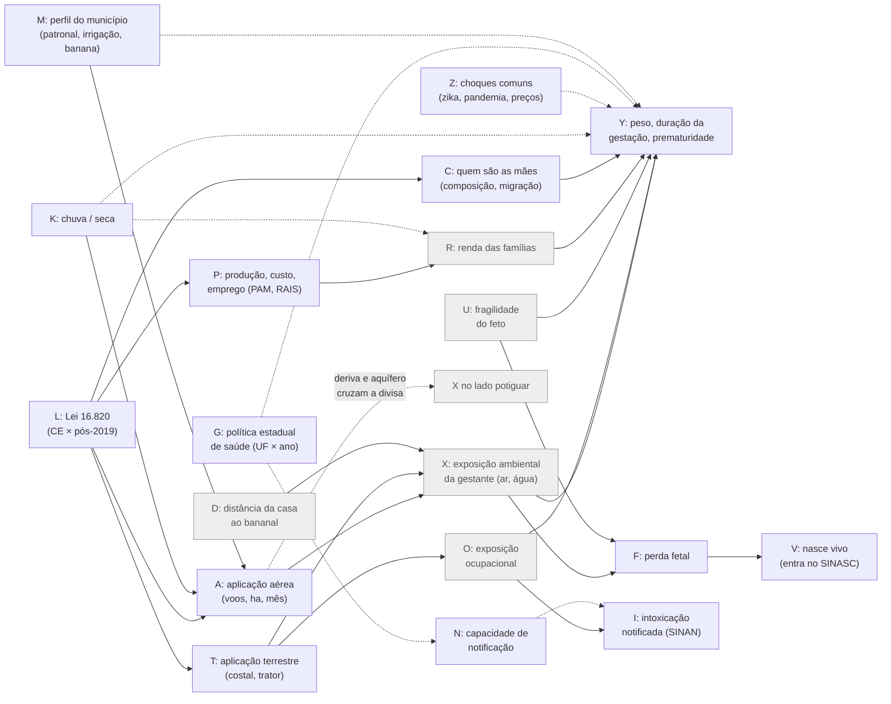

# O encadeamento causal do Ensaio 1 — DAG, hipóteses e o que Callaway & Sant'Anna estimam

*2026-11-16. Complementa o `framework-dissertacao.md` (§2 a §5): lá está o
plano; aqui está o grafo que o justifica, caminho por caminho.*

> **Sobre os DAGs do começo da pesquisa.** Procurei e não achei: não há
> diagrama causal em nenhum arquivo do repositório, nem no histórico de 89
> commits (o único arquivo apagado é `programa-pesquisa.md`, que trata de outro
> tema), nem no Drive. Se foram feitos numa conversa ou em papel, não ficaram
> salvos. O grafo abaixo foi **reconstruído** a partir da teoria da mudança do
> framework e das leituras desta semana. ⬜ Se o original aparecer, vale
> comparar nó a nó.

---

## 1. O grafo

Renderiza no GitHub. Linha cheia: caminho causal de interesse. Tracejada:
caminho que ameaça a identificação. Em cinza: não observado.



O mesmo grafo em código, para colar em `dagitty.net` e pedir os conjuntos de
ajuste e as independências implicadas:

```
dag {
  L [exposure]
  Y [outcome]
  X [latent]
  O [latent]
  R [latent]
  U [latent]
  D [latent]
  L -> A -> X -> Y
  L -> T -> X
  T -> O -> I
  O -> Y
  X -> F -> V
  U -> F
  U -> Y
  L -> P -> R -> Y
  L -> C -> Y
  K -> A
  K -> R
  K -> Y
  M -> A
  M -> Y
  D -> X
  Z -> Y
  G -> Y
  G -> N -> I
}
```

`L` não tem seta de entrada: no desenho, a lei é função de estado e data, e
nada mais. É isso que o DiD explora. As ameaças são tudo o que também varia com
estado e data.

---

## 2. Lendo o grafo: seis caminhos de L até Y

O que Callaway & Sant'Anna estimam é o **efeito total** da lei sobre o
desfecho, por todos os caminhos de uma vez. Só o primeiro é a história que a
dissertação quer contar.

| # | caminho | o que é | sinal esperado em peso ao nascer | como separar |
|---|---|---|---|---|
| 1 | L → A → X → Y | a lei tira o avião, cai a deriva, melhora o nascimento | + | é o alvo. Exige o **primeiro estágio**: L → A medido (LAI ao MAPA) |
| 2 | L → T → X → Y | o produtor troca avião por aplicação terrestre, que também expõe, menos | − ou nulo | não se separa do 1; o efeito estimado é líquido da substituição. Declarar |
| 3 | L → T → O → Y | mais gente aplicando à mão; pais expostos | − | SINAN não intencional como sinal de O. Se I sobe, este caminho existe |
| 4 | L → P → R → Y | a lei muda produção e emprego, que mudam renda, que muda nascimento | ± | PAM e RAIS como desfechos. Se P não se move, o caminho está fechado |
| 5 | L → C → Y | a lei muda quem mora ou engravida ali | ± | características maternas como desfecho (idade, escolaridade, gemelaridade). É o teste de balanceamento de Calzada et al. |
| 6 | L → A → X → F → V | menos perda fetal: nascem fetos que antes não nasciam | − sobre a média de Y | ver §4 |

**Consequência para o texto.** O ATT não é "o efeito da exposição". É o efeito
de estar sob a lei. Para atribuí-lo ao caminho 1, o ensaio mostra, nesta ordem:
que A caiu (primeiro estágio), que P e C não se moveram (caminhos 4 e 5), e o
que aconteceu com I (caminho 3). É análise de mecanismo no sentido da
disciplina (M03, s.41–47): impacto observado, mais a verificação de por qual
elo da cadeia ele passou.

**Controles que não entram** (regra tirada do grafo): nada que esteja a jusante
de L. Pré-natal, tipo de parto e local do parto podem responder à lei.
Condicionar neles fecha parte do efeito ou abre caminho espúrio. As covariáveis
do estimador são todas de linha de base.

---

## 3. O que ameaça, e o que fecha cada caminho

A hipótese de identificação é uma só: **sem a lei, o desfecho dos municípios
cearenses da Chapada teria evoluído como o dos potiguares**. No grafo, isso
equivale a dizer que nenhum nó que aponta para Y muda de forma diferente nos
dois lados em 2019, a não ser por causa de L.

| nó | por que ameaça | o que o desenho faz | o que sobra | teste |
|---|---|---|---|---|
| **M** perfil do município | municípios de fruticultura patronal têm outro nível de Y | fixo no tempo: sai na diferença | tendências diferentes por perfil | estudo de evento; covariáveis de 2010 no estimador duplamente robusto |
| **K** chuva e seca | move A, renda e Y. A seca de 2012–2017 é o maior choque da janela | mesma chapada, mesmo clima: comum aos dois lados | efeito da seca diferente por estrutura de irrigação | controles potiguares da mesma chapada, e não do estado inteiro; checar chuva municipal nos dois lados |
| **Z** choques comuns | zika (2015–16), pandemia (2020–21), preços | comuns: saem com o controle | resposta estadual diferente à pandemia | ver G |
| **G** política estadual | **a ameaça que o desenho de fronteira não fecha.** Todos os tratados estão num estado só; qualquer programa cearense de saúde materna que comece perto de 2019 se confunde com a lei | — | tudo | **diferença tripla** (§5.2) e o desenho de calendário (§5.3) |
| **N** notificação | o SINAN mede notificação, que depende de vigilância, que é estadual | — | idem | CNES nos dois lados; SIH como segunda medida; tentativa de suicídio como placebo |
| **deriva e aquífero** | o avião cearense expunha também o lado potiguar. A lei melhora o controle junto: viola a hipótese de que o controle não é afetado (IC, s.6) | — | viés **contra** achar efeito | excluir os municípios potiguares colados à divisa; gradiente por distância à divisa |
| **antecipação** | o PL é de 2015 e a aprovação é de 12/2018; produtores podem ter parado antes | período de base anterior a 2015 | — | o parâmetro de antecipação do `did`; leads do estudo de evento |
| **drones** | o lado potiguar pode usar drone desde ~2021; o Ceará, desde 12/2024 | corte em 19/12/2024 | mudança no controle depois de 2021 | sensibilidade com pós até 2021 |

O que o grafo deixa claro, e que as tabelas de ameaças anteriores misturavam:
**só uma ameaça fica inteiramente aberta no desenho principal, e é G.** As
outras ou saem por construção ou enviesam contra o resultado.

---

## 4. O colisor: só se observa quem nasce vivo

`V` é filho de `F`, e `F` é filho de `X` e de `U` (a fragilidade do feto, não
observada, que também afeta Y). O SINASC condiciona em V = 1. Se a lei reduz a
perda fetal, passam a nascer fetos mais frágeis, que entram na cauda de baixo
peso. O efeito sobre o peso médio dos nascidos vivos fica **atenuado, e pode
inverter**, mesmo com a exposição caindo.

Não há ajuste que resolva; há o que medir ao lado.

| o quê | por quê | fonte |
|---|---|---|
| Óbito fetal como desfecho próprio | é `F` observado, em parte (só perdas tardias são registradas) | SIM |
| Nascimentos + óbitos fetais como denominador | desfaz o condicionamento para as perdas registradas | SINASC + SIM |
| Razão de sexos ao nascer | fetos masculinos são mais vulneráveis; a razão responde à perda seletiva. O *working paper* de Calzada et al. observa 48,5% de meninas em áreas não expostas e mais de 52% nas expostas | SINASC, sem custo |
| Número de nascimentos | se a perda precoce cai, nascem mais | SINASC |

Se a razão de sexos e o número de nascimentos não se movem, o colisor é pequeno
e o efeito sobre o peso pode ser lido diretamente.

---

## 5. Do grafo ao estimador

### 5.1 Desenho principal: Callaway & Sant'Anna, uma coorte

| elemento | escolha | de onde vem no grafo |
|---|---|---|
| unidade | município × ano-mês de nascimento | — |
| grupo `g` | 2019 para os cearenses da Chapada (Limoeiro do Norte, Quixeré, Russas); nunca tratado para os potiguares | L é função de estado e data |
| comparação | "nunca tratados": os municípios potiguares da Chapada | compartilham K, Z e o perfil M |
| parâmetro | `ATT(2019, t)`, um por período, agregado em estudo de evento | efeito total de L sobre Y |
| covariáveis | só de linha de base: população e urbanização (Censo 2010), área irrigada, participação da agricultura não familiar | condicionar em M; nada a jusante de L |
| estimador | duplamente robusto (Sant'Anna & Zhao 2020) | protege contra erro em um dos dois modelos |
| antecipação | período de base anterior ao PL de 2015 | seta de antecipação |
| peso | número de nascimentos da célula | taxa municipal sem peso é ruído |

**Quatro hipóteses, cada uma com o nó que a ameaça.**

1. **Tendências paralelas condicionais** entre os dois lados da Chapada.
   Ameaçada por G. Testada, mas não provada, pelos períodos pré.
2. **Sem antecipação** antes do período de base.
3. **Sobreposição:** há potiguares com o mesmo perfil dos cearenses. A Chapada
   garante por construção; conferir a tabela de equilíbrio.
4. **O controle não é afetado.** Ameaçada pela deriva e pelo aquífero.

**Tempo de exposição.** A lei entra em vigor em 09/01/2019. Quem nasce em
fevereiro de 2019 teve a gestação quase inteira sob o regime anterior. O efeito
deve crescer ao longo de 2019 e estabilizar a partir das concepções de 2019. O
estudo de evento em meses mostra isso; é uma previsão de forma, que um efeito
espúrio de calendário não reproduz.

### 5.2 Fechando G: a diferença tripla dentro de cada estado

G atinge o estado inteiro; a lei só importa onde havia avião. Isso dá um
segundo grupo de comparação **dentro do Ceará**.

```
DDD = [ (Chapada CE − resto do CE) pós − pré ]
    − [ (Chapada RN − resto do RN) pós − pré ]
```

A primeira diferença tira tudo o que é cearense e varia no tempo (G, N). A
segunda tira o que é próprio de município de fruticultura irrigada e varia no
tempo, nos dois estados. Sobra a lei onde ela morde. Exige uma única tendência
paralela, a da diferença entre os dois contrastes (Olden & Møen 2022).

O "resto" de cada estado não pode ser qualquer município. O candidato natural
são os que **não tinham aplicação por aeronave no Censo de 2006**, e aqui entra
o achado desta sessão:

> **As tabelas do Censo Agropecuário saem por município** (conferido nos
> metadados da API do IBGE em 2026-11-16; nível territorial N6 nas cinco).
>
> | tabela | ano | o que dá |
> |---|---|---|
> | **2069** | 2006 | estabelecimentos por uso de agrotóxico × **tipo de equipamento (inclui "por aeronave")** × agricultura familiar e não familiar × pessoas intoxicadas |
> | 2147 | 2006 | o mesmo, com orientação técnica e escolaridade |
> | **6851** | 2017 | estabelecimentos por tipologia (familiar, não familiar) × uso de agrotóxico |
> | 6852 | 2017 | idem, com orientação técnica e grupos de área |
>
> A 2069 mede o **método por tipo de agricultura**, antes de tudo: quantos
> estabelecimentos não familiares usavam avião em cada município. É a variável
> de heterogeneidade do framework §4.3 em estado puro, e é anterior à lei, à
> seca e ao PL.

### 5.3 Concentrando o sinal: o calendário

O grafo tem `K → A`: o avião voa na quadra chuvosa, de fevereiro a maio, contra
a sigatoka. E Calzada et al. mostram que o efeito está no 1º e no 2º trimestre.
Então, dentro de cada município e ano, há gestações que atravessam a estação de
aplicação no início e gestações que não.

```
DDD-calendário = [ (concebidos para ter o 1º–2º trimestre em fev–mai
                    − demais) pós − pré ] no lado cearense
               −  o mesmo no lado potiguar
```

O que isso fecha: **tudo o que varia por município e ano**, G inclusive, porque
a comparação é entre crianças do mesmo município nascidas no mesmo ano. O que
deixa aberto: uma mudança em 2019 da sazonalidade dos nascimentos que seja
diferente no lado cearense. A composição sazonal das mães é ameaça conhecida
(Buckles & Hungerman 2013; Currie & Schwandt 2013), e por isso o teste do
caminho 5 se repete aqui, por estação.

É também onde o projeto tem mais chance: o efeito esperado na média municipal
anual é de 1 a 2 gramas (`leituras-segunda-rodada.md` §4.3); concentrado nas
coortes expostas, é várias vezes isso. `14_mde_calendario.py` calcula o poder.

### 5.4 Se o avião parou em 2012

O grafo já contém o caso: `K → A`. A seca desligou A no lado cearense anos
antes de L. Então em 2019 a seta `L → A` não tem o que remover, e o caminho 1
fica mudo. A variação de A está em 2012, e quem a causa é K, que tem dois
outros caminhos até Y (`K → R → Y` e `K → Y`).

O desenho de fronteira ainda identifica, sob uma hipótese mais exigente e que
precisa ser dita: **a seca afetou renda e saúde igualmente nos dois lados, e só
de um lado desligou o avião**. Vale se o lado potiguar não pulverizava (então
nada mudou lá em A) ou se continuou pulverizando. Não vale se os dois lados
pararam juntos: aí não há contraste. O relatório do MAPA diz qual dos três.

| o que o registro do MAPA mostrar | contraste que identifica | estimando |
|---|---|---|
| voo no lado cearense até 2018; lado potiguar tanto faz | 2019, como planejado | efeito de a lei remover a exposição |
| lado cearense para em 2012; potiguar não voava ou segue voando | 2012 (e 2019 como teste de que a lei não acrescentou) | efeito de cessar a exposição; a lei consolidou |
| os dois lados param em 2012 | nenhum na fronteira; resta o calendário **antes de 2012**, dentro do lado cearense | efeito da exposição sazonal, à maneira de Calzada |

A terceira linha é a saída mais fraca, e ainda é um resultado: a comparação de
coortes por estação, em 2005–2011, nos municípios onde o avião está documentado
com planilha de voo (Marinho et al. 2011).

---

## 6. O que cada peça do grafo pede em dado e em código

| nó | variável | fonte | estado |
|---|---|---|---|
| L | estado × data | lei | ✅ |
| A | área e mês de aplicação aérea, por município | LAI ao MAPA (IN 2/2008, Anexo V) | ⬜ protocolar. **É o primeiro estágio** |
| A, linha de base | estabelecimentos com aplicação por aeronave, por tipo de agricultura | Censo Agro 2006, tabelas 1008 e **2069** | 1008 ✅; 2069 ⬜ ingestor |
| T, O | intoxicação não intencional; tentativa de suicídio (placebo) | SINAN/IEXO; SIH | ✅ CE; ⬜ RN |
| Y | peso, baixo peso, semanas de gestação, prematuridade | SINASC, por mês e município de residência | ✅ CE 2015–22; ⬜ RN e 2005–2014, 2023–24 |
| F | óbito fetal | SIM/DOFET | ✅ CE; ⬜ RN |
| V | razão de sexos; número de nascimentos | SINASC | sai do mesmo arquivo |
| P | área, produção e valor da banana; vínculos na agricultura | PAM (SIDRA responde); RAIS | PAM ✅; ⚠️ não olhar o recorte tratado × controle pós-2019 antes da pré-especificação. RAIS ⬜ |
| C | idade, escolaridade, gemelaridade, estado civil da mãe | SINASC | sai do mesmo arquivo |
| K | chuva mensal por município | FUNCEME, INMET, ou grade climática | ⬜ |
| M | população, urbanização (2010); irrigação; agricultura não familiar | Censo 2010; Censo Agro 2006 e 2017 (tabelas 2069, 6851) | ⬜ ingestor |
| N | unidades de vigilância e hospitais | CNES | ⬜ |
| D | domicílios a 150 m de bananal | setores censitários 2022 × área de banana | setores ✅; cruzamento ⬜ |

**Ordem de trabalho que o grafo sugere.**

1. Protocolar a LAI ao MAPA (nó A).
2. Baixar SINASC e SIM dos dois estados, 2005–2024 (nós Y, F, V, C).
3. Ingestor das tabelas 2069 e 6851 (nós M e A de linha de base); fixar as
   listas de municípios da Chapada e do "resto" de cada estado.
4. Registrar a pré-especificação: desfecho primário, as três especificações
   (§5.1 a §5.3), os três cenários do §5.4 e a ordem dos testes de mecanismo.
5. Poder: `make mde-desenhos` e `make mde-calendario`, só com o pré-período.
6. Escrever `scripts/estimate/01_did_chapada.R` e estimar.

---

## 7. O que este documento não resolve

- A hipótese de tendências paralelas não se prova. Os períodos pré e o
  HonestDiD (`07_honestdid.R`) dizem quanto de violação o resultado aguenta.
- Com três municípios tratados, a inferência é por permutação e pelos métodos
  de poucos grupos tratados (Conley & Taber 2011; Ferman & Pinto 2019). Na
  diferença tripla e no calendário, o número de grupos tratados continua sendo
  três.
- `X` e `D` são latentes: nenhum dado do projeto observa a exposição da
  gestante. Tudo aqui é efeito de intenção de tratar no nível do município.
